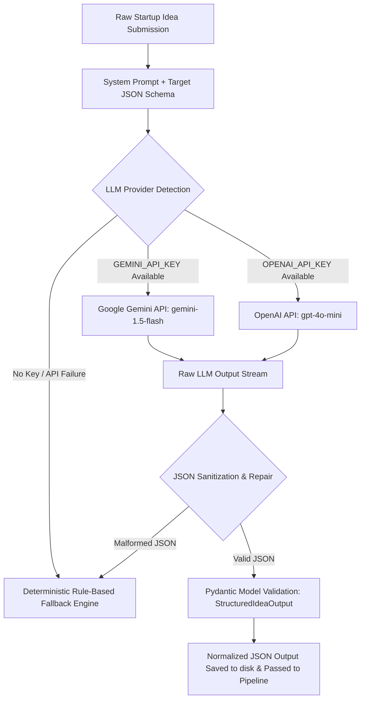

# Task 2: Implement Structured Idea Extraction Using an LLM

**Project Title:** AI Startup Idea Validator  
**Module:** Idea Ingestion & LLM Structured Extraction  
**Date:** October 2026  

---

## 1. Overview & Objective

The goal of this task is to connect an unstructured or semi-structured startup idea submission to a Large Language Model (LLM) and extract a standardized, machine-readable JSON structure.

The extracted output strictly organizes:
* **Problem Statement:** The core pain point or market friction.
* **Proposed Solution:** The product or platform concept addressing the problem.
* **Target Customers:** Specific user persona, company size, or customer archetype.
* **Industry:** Standardized vertical/sector.
* **Key Features:** A concrete list of 3–5 core MVP capabilities.

---

## 2. LLM Integration Architecture



---

## 3. Handling Invalid Responses and API Errors

The implementation includes 4 defensive engineering layers:

| Vulnerability | Failure Mode | Mitigation in Code |
| :--- | :--- | :--- |
| **Missing API Keys** | Missing `.env` or unset credentials | Automatically logs a warning and smoothly switches to the deterministic rule-based extractor so the system never crashes. |
| **API Errors / Network Outage** | 401 Unauthorized, 429 Quota Exceeded, 500 Server Error | Wrapped in `try...except` blocks; catches network timeouts and library exceptions, triggers fallback, and marks status in metadata. |
| **Chatty LLM Outputs** | LLM adding preamble like *"Here is your JSON:"* or backticks ````json ... ```` | `clean_and_parse_json()` strips markdown code blocks and uses regular expressions (`re.search(r"(\{.*\})", ...)`) to isolate pure JSON. |
| **Schema Inconsistencies** | Missing keys or wrong types | Validated against the `StructuredIdeaOutput` Pydantic class before returning. |

---

## 4. Code Implementation

* **Models:** [`src/models.py`](file:///c:/Users/Shravya%20K/OneDrive/Desktop/infosys/src/models.py) (defines `StructuredIdeaOutput`)
* **Extractor Engine:** [`src/idea_extractor.py`](file:///c:/Users/Shravya%20K/OneDrive/Desktop/infosys/src/idea_extractor.py)
* **Output File:** [`data/sample_submission_output.json`](file:///c:/Users/Shravya%20K/OneDrive/Desktop/infosys/data/sample_submission_output.json)

---

## 5. Sample Input vs. Extracted Structured JSON Output

### Input Submission:
```text
Startup Name: FleetPulse EV
Description: AI-powered dynamic routing, battery state-of-health management, and smart charging scheduling platform designed for mid-sized commercial delivery fleets transitioning from diesel to electric vehicles. Solves unpredictable battery drain and high peak-electricity charging tariffs.
Target Customers: Fleet operations managers at regional logistics companies with 15 to 250 electric delivery vans
Industry: Logistics & CleanTech
```

### Extracted Structured Output (JSON):
```json
{
  "idea_name": "FleetPulse EV",
  "problem_statement": "AI-powered dynamic routing, battery state-of-health management, and smart charging scheduling platform designed for mid-sized commercial delivery fleets transitioning from diesel to electric vehicles. Solves unpredictable battery drain and high peak-electricity charging tariffs.",
  "proposed_solution": "An automated, intelligent platform providing Logistics & CleanTech capabilities for Fleet operations managers at regional logistics companies with 15 to 250 electric delivery vans.",
  "target_customers": "Fleet operations managers at regional logistics companies with 15 to 250 electric delivery vans",
  "industry": "Logistics & CleanTech",
  "key_features": [
    "Dynamic routing and schedule optimization engine",
    "Battery health telemetry and real-time degradation monitor",
    "Automated off-peak charging scheduler with utility tariff integration",
    "Interactive operations dashboard and vehicle analytics"
  ],
  "extraction_source": "LLM_GEMINI",
  "status": "success"
}
```

---

## 6. How to Run & Verify

In your terminal:
```powershell
python src/idea_extractor.py
```
