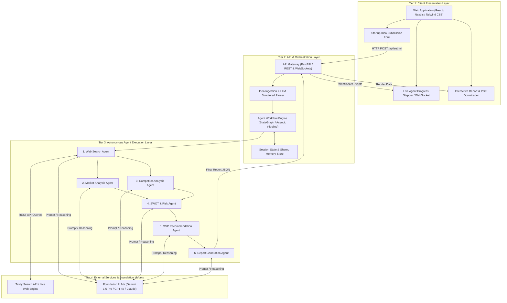
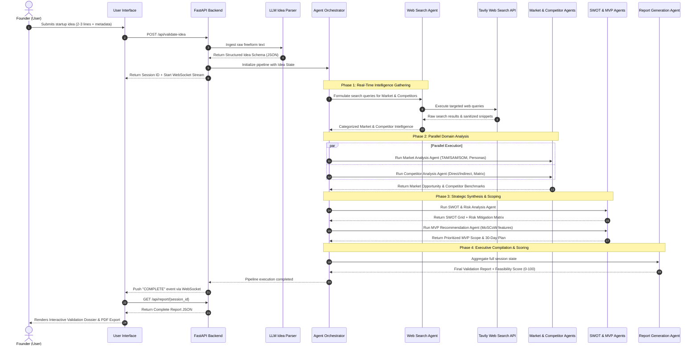

# Task 3: System Architecture & Data Flow Design

**Project Title:** AI Startup Idea Validator  
**Milestone:** 1 (Week 1–2)  
**Date:** October 2026  

---

## 1. System Architecture Overview

The **AI Startup Idea Validator** uses a modern, modular, service-oriented multi-agent architecture. It decouples the user-facing web interface, backend workflow orchestration, autonomous agent reasoning, and external API integrations into clearly delineated tiers.

---

## 2. Component Roles and Responsibilities

| System Component | Technology Stack | Core Role & Responsibilities |
| :--- | :--- | :--- |
| **User Interface (UI)** | React / Tailwind CSS / HTML5 | • Provides an intuitive, responsive submission portal for founders. • Streams real-time visual progress as each agent activates and completes. • Renders the final interactive report with charts, SWOT matrices, and PDF export. |
| **Backend API Layer** | FastAPI / Python 3.11 / Pydantic | • Exposes asynchronous REST endpoints for submission, status polling, and report retrieval. • Maintains persistent WebSocket connections for real-time status streaming. • Enforces request validation and rate limiting. |
| **LLM Reasoning Engine** | Google Gemini / OpenAI API | • Performs contextual reasoning, entity extraction, competitive synthesis, and report drafting. • Governed by strict system prompts and structured output schemas (JSON/Pydantic). |
| **Web Search API** | Tavily Search API | • Delivers clean, low-latency, real-time web intelligence specifically parsed for LLMs. • Eliminates training cutoff limitations and verifies live market facts, competitors, and pricing. |
| **Workflow Orchestrator** | Custom Async Pipeline / LangGraph | • Coordinates the sequence and parallel execution of agents. • Manages the shared state dictionary (context passing between agents). • Implements error handling, retries, and fallback logic if an agent fails. |

---

## 3. End-to-End Information Flow

Here is the step-by-step trace of how a submitted startup idea flows through the system to become an executive validation report:

### Detailed Execution Stages:
1. **Intake & Normalization:** Founder fills out the submission form. The backend uses an extraction prompt to transform unstructured founder notes into a validated Pydantic model containing canonical industry categories, key search terms, and pain points.
2. **Search Orchestration:** The Web Search Agent generates queries such as `"[Industry] market size 2025 2026 report"`, `"[Idea keywords] top competitors pricing"`, and `"[Problem] customer challenges"`. It queries Tavily and aggregates verified sources.
3. **Parallel Analysis:** The Market Analysis Agent and Competitor Analysis Agent run simultaneously, utilizing the fresh search context to calculate TAM/SAM/SOM and map existing player gaps.
4. **Synthesis & Risk Mapping:** Armed with market numbers and competitor strengths, the SWOT & Risk Agent maps out vulnerability profiles and execution roadblocks.
5. **Product Scoping:** The MVP Recommendation Agent takes those risks and competitive gaps, determining the leanest feature set required to validate the core value proposition.
6. **Report Compilation & Scoring:** The Report Generation Agent computes a weighted viability score (0–100), summarizes go-to-market next steps, and formats the final artifact for immediate founder review.

---
*Authored for Infosys AI Startup Idea Validator Project — Milestone 1 Deliverable.*
