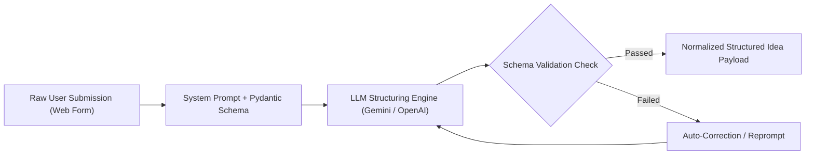

# Task 4: Startup Idea Submission Module Design

**Project Title:** AI Startup Idea Validator  
**Milestone:** 1 (Week 1–2)  
**Date:** October 2026  

---

## 1. UI Wireframe Specification

The submission module serves as the primary gateway for founders. It must balance simplicity (minimal friction so founders can submit in 60 seconds) with sufficient structure to seed downstream agents with actionable data.

### UI Layout & Form Fields
The interface is designed with a modern, distraction-free container featuring clear guidance tooltips:

```
+--------------------------------------------------------------------------------------------------+
|  [LOGO] AI Startup Idea Validator                      [Docs]  [Sample Ideas]  [API Status: Live]|
+--------------------------------------------------------------------------------------------------+
|                                                                                                  |
|   Validate Your Startup Idea in Minutes with Autonomous AI Agents                                |
|   Enter a brief summary of your concept. Our multi-agent swarm will research market demand,      |
|   discover competitors, identify risks, and recommend your MVP roadmap.                          |
|                                                                                                  |
|   +------------------------------------------------------------------------------------------+   |
|   | 1. Startup Name / Project Working Title                                                  |   |
|   | [ FleetPulse EV                                                                        ] |   |
|   |                                                                                          |   |
|   | 2. Idea Description & Core Problem (2-4 sentences) *                                     |   |
|   | [ AI-powered dynamic routing, battery state-of-health management, and smart charging   ] |   |
|   | [ scheduling platform for mid-sized commercial delivery fleets transitioning to EVs.   ] |   |
|   | [ Solves range uncertainty, battery degradation, and peak electricity tariff surcharges. ] |   |
|   |                                                                                          |   |
|   | 3. Target Customer / Ideal User Persona *                                                |   |
|   | [ Fleet operations managers at regional logistics companies and parcel delivery fleets ] |   |
|   | [ operating 15 to 250 electric vans.                                                   ] |   |
|   |                                                                                          |   |
|   | 4. Industry / Primary Vertical *                                                         |   |
|   | [ Logistics & Supply Chain               [v] ]                                            |   |
|   |   (Options: Logistics, HealthTech, FinTech, EdTech, CleanTech, SaaS, Consumer, etc.)    |   |
|   |                                                                                          |   |
|   | 5. Monetization Hypothesis / Business Model (Optional)                                   |   |
|   | [ B2B SaaS subscription: $50 / vehicle / month + tiered enterprise API integration       ] |   |
|   |                                                                                          |   |
|   | 6. Known Competitors or Existing Alternatives (Optional)                                 |   |
|   | [ Geotab, Samsara, OptimoRoute, manual Excel schedules                                   ] |   |
|   |                                                                                          |   |
|   | 7. Geography / Target Market Region                                                      |   |
|   | [ North America & Western Europe         [v] ]                                            |   |
|   |                                                                                          |   |
|   |    [ x ] Enable Live Real-Time Web Search Verification (Tavily API)                      |   |
|   |                                                                                          |   |
|   |                     [  🚀 Launch Multi-Agent Validation Pipeline  ]                      |   |
|   +------------------------------------------------------------------------------------------+   |
|                                                                                                  |
|   Real-Time Pipeline Status Preview:                                                             |
|   [ 1. Web Search ] ---> [ 2. Market Sizing ] ---> [ 3. Competitors ] ---> [ 4. Report Ready ]   |
|                                                                                                  |
+--------------------------------------------------------------------------------------------------+
```

---

## 2. LLM Conversion Pipeline (Unstructured to Structured)

Founders frequently write messy, incomplete, or buzzword-heavy descriptions. The system runs an **Idea Ingestion & Structuring Pipeline** that cleans, validates, and normalizes the input into a strict Pydantic JSON schema before triggering downstream research agents.



### System Prompt for Idea Structuring

```text
You are an expert Startup Architect and Venture Capital Analyst.
Your task is to ingest an unstructured or semi-structured startup idea submission from a founder and transform it into a standardized, high-precision JSON payload.

Follow these strict rules:
1. Extract the core problem, proposed value proposition, and customer segment clearly without buzzword fluff.
2. Formulate 3-5 specific, high-intent web search queries that our Web Search Agent can execute to verify market size, competitors, and industry trends.
3. Classify the industry into a primary and secondary vertical.
4. Output MUST conform strictly to the provided JSON schema without any markdown commentary outside the JSON block.
```

---

## 3. Pydantic Data Model (Code Contract)

```python
from pydantic import BaseModel, Field
from typing import List, Optional

class StructuredStartupIdea(BaseModel):
    idea_id: str = Field(description="Unique UUID for this validation session")
    idea_name: str = Field(description="Normalized project or brand title")
    tagline: str = Field(description="Crisp 1-sentence elevator pitch")
    primary_industry: str = Field(description="Primary industry classification")
    secondary_industry: Optional[str] = Field(description="Secondary or cross-sector vertical")
    target_geography: str = Field(default="Global", description="Initial target geographic market")
    
    # Problem & Solution
    problem_statement: str = Field(description="Clear articulation of the pain point being solved")
    value_proposition: str = Field(description="How the product solves the problem and quantifiable benefit")
    
    # Customer Persona
    target_customer_role: str = Field(description="Specific job title or consumer persona")
    target_customer_profile: str = Field(description="Firmographic or demographic details")
    customer_urgency: str = Field(description="'Painkiller' or 'Vitamin' assessment with rationale")
    
    # Business Model
    monetization_model: str = Field(description="B2B SaaS, Marketplace, Usage-based, Transactional, etc.")
    pricing_hypothesis: Optional[str] = Field(description="Estimated price point or pricing structure")
    
    # Downstream Search Seeding
    search_keywords: List[str] = Field(description="Keywords for web retrieval")
    search_queries: List[str] = Field(description="Pre-formulated search queries for the Web Search Agent")
```

---

## 4. Sample Structured Output for "FleetPulse EV"

Below is the verified JSON representation generated from our sample startup idea:

```json
{
  "idea_id": "idea-ev-8924b1",
  "idea_name": "FleetPulse EV",
  "tagline": "AI-powered dynamic routing and battery intelligence for commercial EV delivery fleets.",
  "primary_industry": "Logistics & Supply Chain Tech",
  "secondary_industry": "CleanTech / Energy SaaS",
  "target_geography": "North America & Western Europe",
  "problem_statement": "Commercial delivery fleets transitioning from diesel to EVs face severe range anxiety, battery degradation from unoptimized rapid charging, and catastrophic peak utility demand charges during depot charging.",
  "value_proposition": "Dynamically coordinates multi-stop delivery routes based on battery telemetry, elevation, and weather, while automatically scheduling overnight charging during lowest-cost off-peak electricity grid windows.",
  "target_customer_role": "Fleet Operations Manager & VP of Logistics",
  "target_customer_profile": "Mid-sized regional parcel couriers, grocery delivery services, and commercial operators running 15 to 250 electric vans.",
  "customer_urgency": "Painkiller. Regulatory mandates are forcing fleet electrification, while energy mismanagement directly creates operational downtime and massive utility surcharges.",
  "monetization_model": "B2B SaaS Subscription (Per-vehicle per-month)",
  "pricing_hypothesis": "$45 - $60 per active vehicle / month, yielding an estimated 5x ROI in energy and maintenance savings.",
  "search_keywords": [
    "commercial fleet electrification software",
    "EV fleet telematics route optimization",
    "smart depot charging management",
    "electric van battery degradation fleet",
    "Geotab Samsara EV fleet management"
  ],
  "search_queries": [
    "commercial EV fleet management market size 2025 2026",
    "best EV fleet route optimization software competitors",
    "smart charging depot energy management SaaS for electric fleets",
    "Fleet electrification operational challenges survey report",
    "Samsara vs Geotab EV telematics capabilities"
  ]
}
```

---
*Authored for Infosys AI Startup Idea Validator Project — Milestone 1 Deliverable.*
