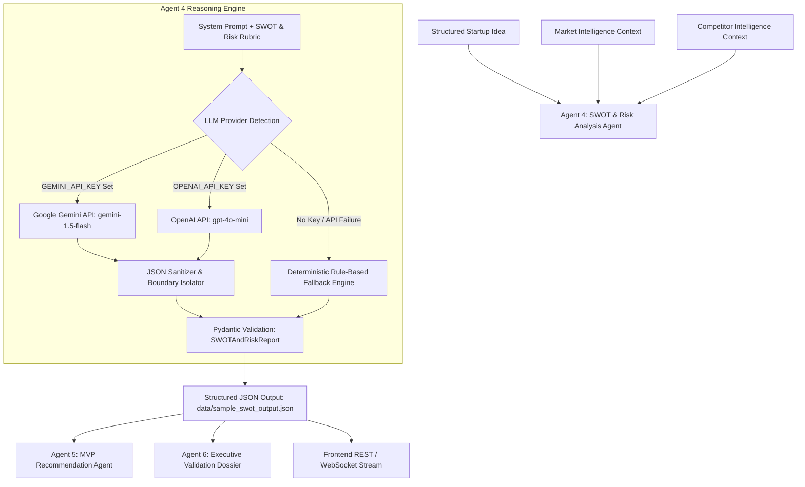

# Task: SWOT & Risk Analysis Agent Implementation

**Project Title:** AI Startup Idea Validator  
**Agent:** Agent 4 — SWOT and Risk Analysis Agent  
**Module:** `src/swot_risk_agent.py` & `src/models.py`  
**Date:** November 2026  

---

## 1. Overview & Objectives

The **SWOT & Risk Analysis Agent** is an autonomous strategic reasoning agent within the **AI Startup Idea Validator** platform. Its role is to synthesize internal startup capabilities, external market forces, and competitive intelligence into an enterprise-grade strategic assessment.

### Core Objectives:
1. **Identify Internal Factors:** Extract distinct **Strengths** (unique advantages, defensible technology, proprietary data) and **Weaknesses** (resource constraints, cold-start limitations, dependency vulnerabilities).
2. **Identify External Factors:** Uncover macro **Opportunities** (regulatory tailwinds, unmet market segments, platform partnerships) and **Threats** (incumbent retaliation, commoditization, utility tariff restructuring).
3. **Conduct Granular Startup Risk Assessment:** Identify high-impact risks across key categories (*Technical Feasibility, Market & Adoption, Regulatory & Compliance, Financial & Runway, Competitive Defensibility, Operational & Execution*), providing root-cause explanations and practical, actionable mitigation strategies.
4. **Structured JSON Output:** Return standardized, Pydantic-validated JSON ready for seamless integration into web dashboards, REST APIs, and downstream agents (e.g., MVP Recommendation Agent).

---

## 2. Agent Architecture & Pipeline Flow

The agent operates as **Agent 4** in the validation pipeline, situated downstream of idea ingestion and real-time intelligence gathering, and feeding directly into MVP scoping and final report compilation:



---

## 3. Data Models Specification (`src/models.py`)

The agent outputs a validated Pydantic model (`SWOTAndRiskReport`) containing four quadrant SWOT analyses and categorized startup risks:

```python
class SWOTItem(BaseModel):
    point: str                       # Concise title of the factor
    explanation: str                 # Detailed contextual explanation and reasoning
    strategic_implication: Optional[str] # Impact on defensibility, runway, or margins

class SWOTAnalysis(BaseModel):
    strengths: List[SWOTItem]
    weaknesses: List[SWOTItem]
    opportunities: List[SWOTItem]
    threats: List[SWOTItem]

class StartupRisk(BaseModel):
    risk_id: str                     # Unique code (e.g., "RISK-01")
    category: str                    # Category (Technical, Market, Regulatory, etc.)
    risk_title: str                  # Short descriptive name of the risk
    likelihood: str                  # "High" | "Medium" | "Low"
    impact: str                      # "High" | "Medium" | "Low"
    overall_severity: str            # "Critical" | "High" | "Medium" | "Low"
    explanation: str                 # Root cause, triggers, and potential failure modes
    mitigation_strategy: str         # Concrete, step-by-step counter-measures

class SWOTAndRiskReport(BaseModel):
    idea_name: str
    industry: str
    executive_summary: str           # High-level synthesis of SWOT & risk posture
    swot_analysis: SWOTAnalysis
    startup_risks: List[StartupRisk]
    overall_risk_level: str          # "Low" | "Moderate" | "High" | "Critical"
    key_strategic_recommendation: str
    agent_metadata: Dict[str, Any]
```

---

## 4. Startup Risk Taxonomy & Mitigation Framework

Risks are assessed against six critical venture failure dimensions:

| Risk Dimension | Primary Root Causes | Mitigation Archetype |
| :--- | :--- | :--- |
| **Technical Feasibility** | Protocol fragmentation (e.g. CAN bus, proprietary APIs), latency, sensor noise, AI hallucination/drift. | Abstracted translation layer, synthetic telemetry benchmarks, vendor-agnostic connector SDKs. |
| **Market & Adoption** | Buyer inertia, 3–6 month enterprise procurement cycles, high switching friction. | 30-day "Shadow Mode" non-intrusive pilots, guaranteed ROI metrics, concierge onboarding. |
| **Regulatory & Compliance** | Data privacy rules (GDPR, CCPA), commercial driver surveillance limits, grid demand tariffs. | Role-based telemetry anonymization, early SOC 2 / ISO 27001 audits, legal privacy compliance whitepapers. |
| **Financial & Runway** | High pilot integration costs, negative early gross margins, extended payback periods. | Mandatory paid Proof-of-Value (PoV) fees, self-serve onboarding automation, annual upfront billing. |
| **Competitive Defensibility** | Legacy incumbents (e.g., Geotab, Samsara) bundling copycat features into existing contracts. | Deep vertical specialization (electrochemistry & utility tariff arbitrage), API co-existence, data flywheels. |
| **Operational & Execution** | Third-party hardware protocol drift (e.g. OCPP quirks), charging firmware mismatch. | Certification with top-tier hardware manufacturers, automated offline fallback charging algorithms. |

---

## 5. Dual LLM Provider Support & Deterministic Fallback

The agent enforces defensive engineering through a 3-tier fallback architecture:

1. **Google Gemini LLM (`gemini-1.5-flash`):** Primary low-latency LLM with strict JSON schema enforcement (`response_mime_type="application/json"`).
2. **OpenAI LLM (`gpt-4o-mini`):** High-reliability secondary provider using `response_format={"type": "json_object"}`.
3. **Deterministic Fallback Engine:** If no API keys are present or if network/quota outages occur, an intelligent rule-based domain analyzer generates high-quality SWOT and risk assessments customized to the startup's industry, problem, and key features. **The system never crashes or halts.**

---

## 6. Verification & Test Suite

The test suite in [`tests/test_swot_risk_agent.py`](file:///c:/Users/Shravya%20K/OneDrive/Desktop/infosys/tests/test_swot_risk_agent.py) executes 8 unit and integration tests:

* `test_json_sanitizer_with_markdown_fences`: Validates stripping of ` ```json ` markers.
* `test_json_sanitizer_with_conversational_chatter`: Validates regex extraction of pure JSON substrings.
* `test_swot_item_and_analysis_models`: Validates Pydantic serialization of SWOT elements.
* `test_startup_risk_model`: Validates risk field constraints and severity calculation.
* `test_agent_analyze_structured_input`: Tests end-to-end analysis on `StructuredIdeaOutput` instances.
* `test_agent_analyze_to_json`: Confirms JSON string conforms to schema and deserializes without error.
* `test_agent_analyze_raw_dict_input`: Validates dictionary input compatibility.
* `test_risk_mitigation_actionability`: Asserts every generated risk contains actionable, non-empty mitigations.

### Running the Tests:
```powershell
python -m unittest tests/test_swot_risk_agent.py
```
*Output: `Ran 8 tests in 0.009s — OK`*

---

## 7. How to Run the Agent

### Standalone Agent Execution:
```powershell
python src/swot_risk_agent.py
```
*Reads [`data/sample_submission_output.json`](file:///c:/Users/Shravya%20K/OneDrive/Desktop/infosys/data/sample_submission_output.json) and writes complete structured JSON to [`data/sample_swot_output.json`](file:///c:/Users/Shravya%20K/OneDrive/Desktop/infosys/data/sample_swot_output.json).*

### Full Pipeline Demonstration:
```powershell
python src/view_sample_pipeline.py
```
*Displays Idea Ingestion (Step 1), Web Search Intelligence (Step 2), and SWOT & Risk Analysis (Step 3).*

---

## 8. Sample Structured JSON Output

```json
{
  "idea_name": "FleetPulse EV",
  "industry": "Logistics & CleanTech",
  "executive_summary": "FleetPulse EV operates in the high-growth intersection of commercial fleet logistics and electrification...",
  "swot_analysis": {
    "strengths": [
      {
        "point": "Coupled Battery Telemetry & Dynamic Route Optimization",
        "explanation": "FleetPulse EV bridges physical battery electrochemistry with dynamic logistics routing...",
        "strategic_implication": "Creates a high-defensibility IP barrier against pure software dispatch platforms..."
      }
    ],
    "weaknesses": [
      {
        "point": "Cold-Start Data Asymmetry for Predictive Battery Models",
        "explanation": "Accurate battery state-of-health modeling requires millions of historical driving data points...",
        "strategic_implication": "Early prediction variance could risk customer dissatisfaction..."
      }
    ],
    "opportunities": [
      {
        "point": "Mandated Corporate Fleet Decarbonization Policies",
        "explanation": "Government mandates (EU Clean Fleets, CA ACT) force commercial operators to electrify...",
        "strategic_implication": "Creates sustained, non-discretionary regulatory tailwinds..."
      }
    ],
    "threats": [
      {
        "point": "Incumbent Telematics Feature Bundling",
        "explanation": "Dominant incumbents (Geotab, Samsara) may launch native EV charging modules...",
        "strategic_implication": "Could trigger price compression or commoditize basic charge scheduling..."
      }
    ]
  },
  "startup_risks": [
    {
      "risk_id": "RISK-01",
      "category": "Technical Feasibility",
      "risk_title": "CAN-Bus & Telematics Protocol Inconsistency Across Vehicle Makes",
      "likelihood": "High",
      "impact": "High",
      "overall_severity": "High",
      "explanation": "Commercial fleets run heterogeneous mixes of electric delivery vans...",
      "mitigation_strategy": "1. Implement an abstracted vehicle telematics translation layer...\n2. Partner with open telematics API aggregators..."
    }
  ],
  "overall_risk_level": "Moderate",
  "key_strategic_recommendation": "Deploy a 30-day non-intrusive 'Shadow Mode' pilot with 3 mid-sized commercial fleets...",
  "agent_metadata": {
    "agent_name": "SWOT & Risk Analysis Agent",
    "model_used": "gemini-1.5-flash",
    "status": "success"
  }
}
```

---
*Authored for Infosys AI Startup Idea Validator Project.*
